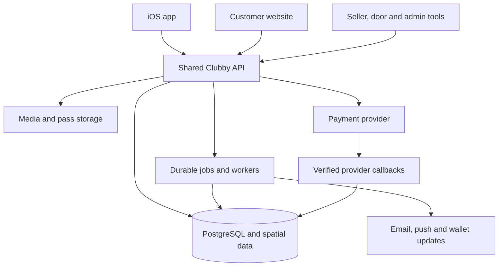

**Clubby implementation plan — one backend for iOS and the website**

Prepared 23 September 2026. Product baseline: `P4210/Project-Clubby`, commit `e121114ac6e3a1262de3958e86774371966cf7b8`. This turns the 24 topics in [the backend readiness audit](BACKEND-READINESS.md) into implementation packages, dependencies, and acceptance criteria. Updated 24 September: implementation and local evidence are recorded in [the workstream completion record](docs/acceptance/workstreams.md) and [phase register](docs/acceptance/phases.json). The user selected local deployment preparation because provider/hosting/Apple accounts are not configured. Cloud provisioning, provider journeys and signed-device acceptance therefore remain external release gates. The original proposed sequence below is retained for traceability; [engineering decisions](docs/architecture/decisions.md) record refinements to that proposal.

**Architecture decision**

Use one shared backend system for the iOS consumer app, customer website, seller workspace, and door/admin tools. They share customer identity, catalogue, inventory, orders, tickets, reservations, payment accounting, and permissions. A purchase made on the website must appear in the customer's iOS app after authentication or verified guest-order claiming. A sale through either channel consumes the same inventory.

The system can run multiple API instances and independent workers for reliability and scale. Public, seller, door, and admin routes have different authorization and exposure rules while using the same domain services and authoritative database. Separate environments have separate data and credentials. A later web rendering layer can call the same API without owning another booking ledger or inventory system.



**Recommended implementation baseline**

| Component | Proposed approach | Reason |
| --- | --- | --- |
| API and domain services | TypeScript/NestJS modular application | Consistent contracts and isolated domain modules; compatible with the separate local scaffold. |
| Persistence | PostgreSQL; PostGIS for spatial querying | Relational integrity, transactional allocation, financial history, and geographic search. |
| Jobs | Database outbox plus durable worker queue; initially a PostgreSQL-backed implementation | Keeps committed work recoverable; add dedicated queue infrastructure when needed. |
| Media | Managed object storage and CDN | Venue/event images, processed variants, generated passes/documents. |
| Identity | Managed identity provider supporting email and Sign in with Apple, integrated with Clubby authorization | Reuses established credential/recovery capabilities while Clubby owns business access. |
| Payments | Evaluate Stripe/Connect as the first candidate in M0 | Native/web client options and seller-payment capabilities; confirm business model and supported seller countries. |
| Notifications | Transactional email provider; iOS push transport through APNs directly or an approved relay | One notification model with platform-specific delivery adapters. |
| Clients | Expo/React Native for iOS; React-compatible web client; shared API contracts and client SDK | Reuse data access/types while retaining platform-specific presentation and payment components. |
| Observability | Central logs, metrics/traces, error collection, alerting | Diagnose an order across checkout, provider events, issuance, delivery, and admission. |

Expo Router supports native and web routing, so the consumer clients may share substantial frontend code as well. Confirm map, payment, camera, and public-page rendering needs during M0; this choice does not change the shared backend. [Expo documentation](https://docs.expo.dev/router/introduction/).

There is already a separate local `Clubby` scaffold containing Expo consumer/seller apps, NestJS modules, contracts, and PostgreSQL-related code. The manager README explicitly identifies its persona login as local testing only, with production/Postgres disablement and incomplete booking-policy integration. Reuse candidates must pass M0 review before they count as implemented. Evidence: [API dependencies](C:/Users/enric/OneDrive/Documentos/ChatGPT/Clubby/apps/api/package.json), [manager limitations](C:/Users/enric/OneDrive/Documentos/ChatGPT/Clubby/apps/api/src/manager/README.md), [iOS/web configuration](C:/Users/enric/OneDrive/Documentos/ChatGPT/Clubby/apps/mobile/app.json). This was a targeted reuse check, not a full audit of that separate implementation.

**What differs between iOS and web**

| Concern | Shared backend work | iOS integration | Website integration |
| --- | --- | --- | --- |
| Identity | One user and linked identities; verified account linking; authorization | Native/system authentication flow and secure credential storage | Secure server session cookie and login redirect handling |
| Session security | Expiry, revocation, replay detection, device/session records | Short-lived access credential; refresh credential in secure OS storage | Secure, HttpOnly cookie; CSRF/origin protections; avoid browser-readable long-lived credentials |
| Checkout | Same order, price, inventory, accounting, and fulfilment rules | Provider's supported native payment UI and Apple Pay where enabled | Hosted/embedded provider checkout and supported browser payment methods |
| Payments during interruptions | Durable payment attempts; provider-event confirmation; order-status retrieval | Recover after app suspension, bank authentication, or termination | Recover after redirect, closed tab, reload, or another browser session |
| Push/messages | Preferences, device registrations, notification events, retry history | APNs/device token lifecycle | Email initially; web push can be added if selected |
| Links | Stable HTTPS routes and expiring invitation/claim records | Universal Links and authenticated navigation after opening | Useful landing/fallback pages on the same links |
| Tickets | Same credential and admission record | In-app display, optional secure offline display, Apple Wallet | Browser display, retrieval links, wallet/download actions |
| Releases | Versioned API and compatibility contracts | Previously installed app versions continue working during rollout | Web can be deployed immediately; still uses compatible contracts |
| Geography | Canonical coordinates, distances, and booking timezone | Foreground location permission and native map integration | Browser permission and web map integration |

OAuth integrations should use established native-app flows, PKCE where applicable, and properly validated provider tokens/redirects. Treat native clients as public clients without embedded server secrets. [Native OAuth guidance](https://www.rfc-editor.org/rfc/rfc8252), [OAuth security guidance](https://www.rfc-editor.org/rfc/rfc9700).

**App Store considerations incorporated into the plan**

- Clubby's current purchases concern services consumed at venues. Apple's 3.1.3(e) requires payment methods other than In-App Purchase for these; use the payment provider/card/Apple Pay route. Future paid digital features need a separate assessment.
- If third-party/social login is offered, apply the conditions and exceptions in 4.8; Sign in with Apple is the proposed compatible option.
- Group chat needs filtering, reporting, blocking, and moderation operations under 1.2.
- The iOS experience must satisfy 4.2's functionality expectations. Reviewers also need working access and available backend services.

These requirements were checked against [Apple's App Review Guidelines](https://developer.apple.com/app-store/review/guidelines/). The plan's native integrations and operational controls below are our engineering response.

Provide in-app initiation of account deletion where accounts can be created, including automatic accounts; complete the deletion workflow and revoke Apple tokens where applicable. [Apple account-deletion guidance](https://developer.apple.com/support/offering-account-deletion-in-your-app/). Maintain a data/SDK inventory so App Store privacy declarations match backend and partner processing. [Apple privacy guidance](https://developer.apple.com/app-store/app-privacy-details/).

**M0 — decisions, reuse assessment, and implementation boundaries**

Complete this design package before committing to payment account structure or permanent booking schema. Catalogue scaffolding can proceed while business inputs are resolved.

1. Produce a feature/contract comparison of the GitHub prototype and local scaffold. Classify each local module as reusable, adaptable, or replaceable, with evidence and tests.
2. Recommend `P4210/Project-Clubby` as the canonical versioned project and document a selective migration path. Preserve the current prototype and local data; transfer only reviewed code, fixtures, and assets. Any later migration must exclude secrets and local customer/test data and retain IDs where needed.
3. Record architecture decisions for identity, hosting region, provider, charge/settlement model, data retention, supported API versions, and client structure. Lock compatible dependency versions after verification.
4. Set the launch-market assumption: Milan/EUR first, with the schema capable of other countries/currencies. Opening a destination for browsing does not automatically enable native seller payments there.
5. Specify seller of record, venue/organizer/platform shares, refund/dispute responsibility, payout timing, tax/invoice inputs, and provider-country eligibility. These require business input before live commerce.
6. Use one admission entitlement per ticket as the proposed default; use event/session-specific table offers. Propose guest ticket checkout and verified accounts for group membership. Keep deposits, deadlines, and refund rules as versioned offer policies; the prototype's 20%/20:00 values are provisional product rules.
7. Specify group table-hold duration, deposit threshold, deadline behavior, excess-payment handling, and the party responsible for an unpaid balance. Default to online authoritative door validation; offline scanning is a separately estimated extension.
8. Create an endpoint/data model review, a threat model, a dependency backlog, test accounts/venues, and an environment plan. Select performance/recovery targets for M8; suggested starting targets appear below.

Exit deliverables: approved engineering contracts and recorded business decisions, a reuse report, a migration proposal, selected provider sandboxes, and an acceptance-test matrix. Unresolved choices remain explicit gates on affected implementation; this plan does not silently decide contractual terms.

**Delivery milestones and dependency gates**

| Milestone | Main output | Workstreams | Exit condition |
| --- | --- | --- | --- |
| M1 — Platform foundation | API/database/worker, migrations, CI, staging, shared contracts, iOS/web development shells | W01; initial W22, W23, W24 | Both clients reach the same staging API; fixtures are isolated from production. |
| M2 — Identity and business access | Customer/guest identity, organizations, invitations, onboarding, minimum admin, identity email, deletion path | W02–W04; early W19, W21, W22 | Cross-client identity works; unauthorized staff/customer access fails. |
| M3 — Catalogue and programming | Locations, venues/media, event proposals, discovery, saved venues, external redirects | W05–W08; catalogue W21 | One approved venue/event change appears consistently on iOS and web. |
| M4 — Complete ticket commerce | Products/holds/orders, payments, ledger, tickets, booking support, admission, transactional delivery | W09–W13, W17–W19; commerce W21–W24 | Complete sandbox buy → deliver → recover → scan → refund → reconcile journey; race tests pass. |
| M5 — Tables and deposits | Versioned floor plans, slot inventory, full/deposit reservations, door balances, policy handling | W14; extensions to W09–W12, W17–W19 | Concurrent cross-channel booking cannot double-book a table; balances reconcile. |
| M6 — Groups and collaboration | Invites, contributions, funding deadlines, chat, live updates, moderation | W15–W16; extensions to W12, W19, W21–W22 | Different iOS/web users fund one real allocation and receive correct contributor refunds. |
| M7 — Product completion | Transfers/wallets, retained dashboard metrics, remaining settings/preferences/support, market controls | completion W05, W11–W13, W18–W22 | Every retained prototype action has a working end-to-end implementation. |
| M8 — Launch readiness | Load/security/recovery checks, device/browser verification, production configuration, App Store review preparation | completion W23–W24, verification of all W01–W24 | Release matrix and operational sign-off pass on both platforms. |

W22–W24 run throughout delivery. W19 begins with identity messages; W21 begins with minimum administration. Packages with mutual integration are delivered through small interfaces and end-to-end increments, not by waiting for an entire neighboring package to finish. Internal iOS device/TestFlight validation starts before commerce completion. A full-scope public launch follows M8; a smaller release requires explicitly disabling deferred features.

**Implementation packages for all 24 topics**

Owners below describe responsibilities, not an assumed team size: Platform, Identity, Catalogue, Commerce, Operations, Client (iOS/web), QA, and Product/Finance. One engineer may fill several roles.

**W01 — Backend application, database, and APIs | M1 | Owner: Platform**

Depends on M0 architecture contracts.

1. Establish the versioned project structure, configuration validation, PostgreSQL connection, migrations, error format, request tracing, health/readiness checks, and dependency lockfiles.
2. Add domain-module boundaries, common ID/money/time primitives, database constraints, optimistic edit versions, and an outbox. Generate a documented OpenAPI contract and typed client SDK.
3. Add API/worker entry points, isolated test databases, seed fixtures, and CI migration/contract tests. Separate read models from commands that change money, stock, or access.

Records/contracts: migration history, idempotency records, outbox/job records; `/health`, `/ready`, and `/v1` contract conventions. Acceptance: empty-database setup and upgrade from the previous schema both succeed; iOS and web call the same API; client bundles contain no server credentials.

**W02 — Accounts and guest checkout | M2, completed before M8 | Owner: Identity + Client**

Depends on W01 and the selected identity provider; uses the early W19 email adapter.

1. Integrate verified email and Apple identities, token validation, stable user IDs, sessions, rotation/revocation, account recovery, and secure identity linking. Do not merge accounts solely by matching an unverified email or Apple relay address.
2. Add guest purchaser/capability records, secure recovery and verified order claiming, profile preferences, account suspension, and account-required checkout policy.
3. Implement deletion initiation, job tracking, confirmation, identity-provider revocation, and a documented treatment of retained transaction records. Add native and browser session adapters against the same user.

Records/APIs: users, identities, sessions, guest claims, deletion requests; auth exchange/refresh/logout, `/v1/me`, session list/revoke, guest claim, deletion request/status. Acceptance: web purchase can be claimed/retrieved on iOS; cookie/CSRF and native token-replay tests pass; revoked or deleted sessions lose access on both.

**W03 — Organizations, permissions, and staff | M2 | Owner: Identity**

Depends on W01 and W02.

1. Migrate organizations, memberships, invitations, venue/event assignments, and capability grants. Define a deny-by-default permission matrix covering public, customer, seller, door, support, finance, and admin operations.
2. Implement invitation acceptance/expiry/revocation and trusted request identity/context loading. Apply resource-scoped authorization to reads, writes, exports, uploads, and realtime subscriptions.
3. Expose authorized workspaces and capabilities for UI navigation; remove local persona grants from deployed builds. Add privileged-session protections and audit events.

APIs: `/v1/workspaces`, memberships, invitations, assignments, capability projections. Acceptance: tests using two organizations cannot read or mutate each other's records by substituting IDs; revocation takes effect on API and realtime access; selecting a UI role cannot elevate privileges.

**W04 — Seller onboarding and commercial status | M2–M4 | Owner: Identity + Commerce + Product/Finance**

Depends on W03 and M0 business/payment decisions; uses the W11 provider adapter contract.

1. Implement organizer applications, venue management assignment/claims, verification/review records, and an audited review queue.
2. Persist agreements, payout-account references and readiness, commission versions, native/external mode, and suspension reasons. Synchronize provider onboarding state.
3. Derive sale eligibility from approved business status and provider capabilities. Implement transitions that preserve valid existing bookings while limiting new sales.

APIs: application submit/review, venue assignment, provider onboarding link/status, commercial-mode transition. Acceptance: an unapproved or payment-disabled seller cannot accept a native purchase through either client; changing status preserves existing admission/refund operations.

**W05 — Destinations, geography, time, and currencies | M3, extension M7 | Owner: Catalogue**

Depends on W01 and W03.

1. Create destination/country/coordinate/timezone/currency models and import reviewed fixture records. Use stable foreign keys with slug aliases/redirect rules.
2. Add geographic indexes and distance/viewport queries; derive destination availability and validate published-state rules.
3. Add local-time scheduling/formatting contracts, DST/overnight handling, and market capability configuration. Enable each additional market only after catalogue and payment-policy readiness checks.

APIs: destinations, destination detail, nearby/viewport catalogue query. Acceptance: the same occurrence has one instant on iOS/web; a city change never changes an order's currency; hidden destinations are excluded consistently; overnight and DST fixtures pass.

**W06 — Venues, hours, and media | M3 | Owner: Catalogue**

Depends on W03–W05 and the W23 storage scaffold.

1. Build venue CRUD, structured schedules/exceptions, tags/genres, contacts, minimum-age policy fields, and draft/publication revisions.
2. Implement scoped upload authorization, type/size checks, quarantine/processing as appropriate, variants, CDN delivery, and safe cleanup.
3. Add controlled publishing, public/detail projections, optimistic edit conflicts, source/import identifiers, and staff preview. Snapshot sold venue information into commerce records.

APIs: public venue detail, seller venue edit/publish, schedule commands, media upload/finalize, import validation. Acceptance: an unauthorized upload/edit fails; two editors receive an explicit conflict; updated media and opening status agree across both clients; hidden content stays out of public discovery.

**W07 — Events and approval workflow | M3 | Owner: Catalogue**

Depends on W03, W04, W05, W06.

1. Implement events and occurrences/sessions with full dates, lineup, assets, organizer relationship, capacity definitions, and lifecycle.
2. Build proposals, revisions, review comments, change requests, resubmission, approval/rejection, and the unique proposal-to-event relationship.
3. Add publish/unpublish/cancel/reschedule commands and expected-version checks. Define the event-change hooks later consumed by bookings, inventory, and notifications.

APIs: seller events/occurrences, proposal submission/review, publication and schedule transitions. Acceptance: retrying approval cannot duplicate an event; rejected/changed proposals retain history; draft occurrences cannot be purchased; material changes to sold occurrences use the defined workflow.

**W08 — Search, discovery, and saved venues | M3 | Owner: Catalogue + Client**

Depends on W05–W07 and W02 for synchronized saves; accurate availability uses W09/W14 as they arrive.

1. Implement indexed search, filters, ranking rules, pagination, public projections, map queries, and invalidation on catalogue publication.
2. Build editorial placements and saved-venue APIs; define an initial curated/trending policy and later metrics integration.
3. Wire both clients to these contracts, replacing in-memory filtering as the authoritative result source. Add availability filters only when backed by real inventory.

APIs: search, map feed, discover collections, save/unsave/list. Acceptance: iOS/web return the same eligible catalogue for the same query and time; hidden content cannot leak through direct links/search; one user's saves appear on their other device only.

**W09 — Ticket products and inventory | M4 | Owner: Commerce**

Depends on W07 and shared W01 money/time/transaction primitives.

1. Migrate products/tiers, sale windows, capacity pools, admission conditions, add-ons, allocations, and holds. Implement explicit free-entry products and independent drink entitlements.
2. Add atomic hold/consume/release commands with lock ordering, database constraints, bounded retries, and per-order limits; coordinate tier and event capacity.
3. Add hold-expiry jobs and reconciliation hooks for payments in flight. Coordinate staff blocks and later table guest allocations with the same capacity rules.

APIs: product availability, create/read/release hold; privileged capacity/block commands. Acceptance: a mixed iOS/web race for one remaining ticket has one winner; expired/consumed holds cannot be reused; capacity cannot be reduced below commitments; a pending provider response never silently loses a paid customer's allocation.

**W10 — Orders and authoritative checkout | M4 | Owner: Commerce**

Depends on W02, W04, W07, W09 and M0 commercial policy.

1. Implement quotes and order/line snapshots with buyer, occurrence, seller, currency, amounts, fees/tax inputs, policy version, and hold references.
2. Add server pricing/eligibility checks and idempotent submission, keyed by principal and operation with request-payload comparison.
3. Implement order recovery, status projections, payment-attempt references, and channel metadata. The same order can be resumed from another authorized client without duplicating a charge.

APIs: quote, create/get order, resume/status, cancel unpaid order. Acceptance: editing client prices has no effect; double submission returns the recorded result; changing destination does not reprice the purchase; web-to-iOS recovery shows the correct state.

**W11 — Payment integration | M4, saved methods M7 | Owner: Commerce + Client**

Depends on W10 and the W12 ledger contract; provider onboarding interfaces are shared with W04.

1. Implement the provider adapter, create/reuse payment attempts, verified callback ingestion, a durable callback inbox, deduplication, and signature verification. Map provider statuses to internal payment events.
2. Add asynchronous fulfilment/reconciliation and compensation for late success after lost inventory. Prevent a retry on another client from leaving two uncontrolled active payment attempts.
3. Integrate native payment UI on iOS and hosted/embedded checkout on web. Add saved-method references/removal, refunds/disputes, and failed/pending paths.

APIs: order payment session, payment status, provider webhook, refund commands, saved-method management. Acceptance: both clients support success, decline, authentication, interrupted return, duplicate/out-of-order callbacks, and delayed settlement; no frontend callback can grant paid admission. Stripe's supported client integrations use server endpoints; verify the chosen SDK/API combination in the M0 sandbox. [Native integration](https://docs.stripe.com/payments/accept-a-payment?payment-ui=mobile&platform=react-native), [web integration](https://docs.stripe.com/payments/accept-a-payment?payment-ui=checkout&ui=stripe-hosted).

**W12 — Ledger, settlements, and payouts | M4 foundation; extends M5–M7 | Owner: Commerce + Finance**

Depends on W01 and M0 money-flow decisions; develops alongside W10/W11 contracts.

1. Implement append-only financial journals with balanced postings per currency, external references, posting idempotency, fee/split versions, and reversal entries.
2. Post charges/refunds/provider fees and seller/platform allocations; reconcile provider balances/transactions and track disputed or unresolved amounts.
3. Integrate provider-supported seller transfers/payouts, failure handling, statements, accounting exports and receipt/invoice generation according to the operating model. Extend postings for deposits, group contributions, and door collection.

APIs: restricted seller/finance statements, settlement/payout status, reconciliation cases, authorized corrections. Acceptance: every financial event is explainable from its order/provider reference; postings balance; refunds after payouts follow the agreed recovery policy; currencies are not silently combined. Marketplace provider capabilities are documented by [Stripe Connect](https://docs.stripe.com/connect); the exact charge model must be settled in M0.

**W13 — Tickets, QR, transfers, and wallets | M4 issuance; M7 full completion | Owner: Commerce + Client**

Depends on W09–W12; delivery uses W19 and admission uses the W17 contract.

1. Implement idempotent ticket issuance per admission unit, unpredictable credentials, state/history, secure retrieval, and separate voucher entitlement links.
2. Implement transfer invitation/acceptance/cancellation, owner changes and credential rotation, with concurrency protection against scans/refunds.
3. Add pass generation, delivery and updates for Apple/Google Wallet, key/certificate management, and client integration. Cache ticket display securely if needed, while server admission remains authoritative.

APIs: tickets/retrieve, credential display, transfer commands, wallet pass delivery/update. Acceptance: eight admissions generate eight valid entitlements; old credentials fail after accepted transfer; refund/reschedule updates propagate; web-purchased tickets open in iOS and are scanned by the same admission service.

**W14 — Floor plans and table bookings | M5 | Owner: Commerce + Catalogue + Client**

Depends on W06–W07 and W09–W12.

1. Migrate layout versions, zones, tables, event/session offers, inclusions, spend/deposit rules, and slot allocations. Decide how table guests interact with event capacity.
2. Implement exclusive table holds, reservation confirmation, deposit/full payment, cancellation/no-show and versioned terms. Enforce the table-slot uniqueness invariant in the database.
3. Add layout editing/public availability APIs and balance/door-settlement commands, with authorized corrections posted to W12.

APIs: occurrence floor plan/offers, table hold/reserve, reservation detail/cancel, balance settlement. Acceptance: simultaneous app/web buyers cannot reserve the same table slot; a different slot remains bookable; layout edits cannot rewrite existing commitments; paid and outstanding balances reconcile.

**W15 — Groups and shared funding | M6 | Owner: Commerce**

Depends on W02–W03, W11–W14 and the M0 funding/expiry policies.

1. Create group, membership/invitation, funding target, inventory-allocation relationship, contribution intent, and deadline records; support several groups per user.
2. Implement scoped invite acceptance and idempotent contributions. Reserve the remaining funding amount during concurrent contribution attempts and account for late settlement, refunds, and disputes.
3. Add deadline/funding transitions, deposit/full confirmation, commitment to pay balance, owner/member changes, and automatic release/refund workflows under the agreed policy.

APIs: group create/read/join, invite/revoke, contribute/status, confirm/cancel, balance commitment. Acceptance: iOS and web members see one correct balance; simultaneous final payments cannot create unexplained excess; unfunded expiry releases inventory and handles each contributor correctly; a chat message cannot count as payment.

**W16 — Chat and realtime collaboration | M6 | Owner: Operations + Client**

Depends on W03, W15, W19 notification primitives and W22 moderation/access contracts.

1. Implement conversation/message persistence, sender identity, membership authorization, message order, pagination and idempotent send.
2. Add authenticated realtime delivery with cursors/reconnect, revocation checks, and group/payment/booking event projections.
3. Build report/block/filter tools and moderation queues with audit records; handle blocked users without obscuring financial obligations or essential booking notices.

APIs: group messages/history, report/block, authenticated event stream or websocket subscription. Acceptance: app background/resume and web reconnect recover missed messages once; removed members cannot read future messages; moderation is usable from both clients and staff tools; displayed contributions come from payment records.

**W17 — Door admission and voucher operations | M4 entry; M5–M7 extensions | Owner: Operations**

Depends on W03, W07, W13; table/balance extensions use W12/W14.

1. Implement atomic ticket validation/redemption for event, time, state, and staff assignment; record scan attempts with bounded sensitive data.
2. Implement per-entitlement voucher redemption, guest lookup, table guest arrival, manual override with reason, and authorized door balance collection.
3. Integrate camera scanning, network/error/retry behavior and operator dashboards. Define re-entry/departure tracking if reporting current occupancy; offline validation remains a separately gated extension.

APIs: admissions redeem/lookup, vouchers redeem, table check-in, door collection, shift summaries. Acceptance: two devices admit one credential once; retry after a lost response returns the same result; wrong-event/refunded/revoked credentials fail; staff cannot scan another venue's event.

**W18 — Booking lifecycle, refunds, and support | M4–M7 | Owner: Commerce + Operations**

Depends on W10–W13; table/group completion follows W14–W15.

1. Build a unified booking read model with dates, fixed currency, attendees, entitlements, balances, purchased policy and lifecycle state.
2. Implement cancellation eligibility and refund orchestration, including event-wide cancellation/rescheduling and synchronization with admissions, transfer, inventory, wallet and ledger states.
3. Add scoped support search/cases, resend, stuck-order recovery, refund review, and audited corrections. Preserve customer retrieval after venue hiding or external-mode change.

APIs: my bookings, secure guest booking detail, cancellation/refund request/status, support case/action, event impact/transition. Acceptance: a cancellation from web appears in iOS and door validation consistently; partial refunds update only affected rights; staff can recover payment-success/fulfilment-failure without creating duplicates.

**W19 — Notifications and preferences | M2 initial; extends M4–M7 | Owner: Operations**

Depends on W01; subscribes to identity/commerce/group events as implemented.

1. Build notification templates, delivery records, preferences and transactional-versus-marketing classifications. Add email verification/invitation/recovery delivery first.
2. Add confirmed purchase, cancellation, refund, deadline and approval events through the outbox; retries, bounce handling, deduplication and support visibility.
3. Add user/device registrations, push token updates/revocation, deep-link payloads and iOS permissions. Keep email/web retrieval functional without push permission; add web push only if selected.

APIs: preferences, register/remove device, notification history/read, delivery status for staff. Acceptance: a repeated provider/job event sends no accidental duplicate confirmation; logging out removes the device's private notifications; reminders use the event timezone and open the correct authorized record.

**W20 — Analytics and reporting | Instrumentation M3–M4; dashboards M7 | Owner: Operations + Finance**

Depends on authoritative W07/W10/W12/W17 events and W03 access controls.

1. Define metrics and event contracts before feature instrumentation: sales, revenue, fees, refunds, admissions, utilization, conversion and repeat buyers.
2. Add idempotent aggregation, reporting windows/timezones, currency separation, finance reconciliation, backfill and freshness timestamps.
3. Replace mock dashboard numbers with scoped reports and exports. Build NPS collection or queue measurement only if those displayed metrics are retained; otherwise remove the unsupported claims.

APIs: organizer/venue/platform dashboards, event performance, finance reports, scoped export jobs. Acceptance: identical filters produce matching cross-client figures; reports match ledger/order totals after refunds; one seller cannot export another seller's customer data.

**W21 — Administration, configuration, and external links | M2 minimum; extends M3–M7 | Owner: Platform + Operations**

Depends on W03; commands delegate to each owning domain module.

1. Build minimum reviewed admin roles, audit viewer and organizer/venue onboarding tools. Store versioned safe public settings separately from credentials.
2. Add catalogue publication, commercial-status controls, external link overrides/fallback, URL validation, native-purchase enforcement and support/finance tools.
3. Add controlled previews, scoped feature flags, emergency pause of new sales, user/member suspension and remaining admin controls. Retain history and existing entitlement operations during pauses.

APIs: admin review/config/visibility commands, public `/v1/bootstrap`, external booking link projection, audit search. Acceptance: admin actions are recorded with actor/reason/version; direct API calls cannot bypass unsigned/hidden restrictions; toggles propagate to both platforms; no secret appears in public config.

**W22 — Security, privacy, and abuse controls | Starts M1; every milestone | Owner: Platform + Identity + Operations**

Depends on M0 threat/data models; enforces controls in all packages.

1. Add validated request boundaries, secure sessions, CSRF/CORS policy, rate/size limits, secret rotation, log redaction, dependency checks, and automated authorization tests.
2. Implement access/export/deletion jobs, retained-data policy, consent/policy evidence, abuse/reporting workflows, invitation/credential revocation, and privacy-safe analytics.
3. Maintain a data/third-party SDK inventory and test actual client/server collection against it. Perform security review and remediation before live commerce and again before submission.

APIs: privacy request/status, abuse report/status, administrative revocation; controls wrap all endpoints/jobs. Acceptance: cross-tenant/booking access, QR replay, stock hoarding, injection and privilege escalation scenarios fail; deletion/export works from either client; logs and analytics exclude credentials and unnecessary personal data.

**W23 — Hosting, workers, and operations | Starts M1; release gate M8 | Owner: Platform**

Depends on M0 hosting/recovery choices and W01 entry points.

1. Provision isolated environments through infrastructure configuration, managed database/storage/secrets, HTTPS routing, deploy/migration pipelines, backup and restore capability.
2. Operate API and workers with health checks, durable outbox/job retries, leases, dead-letter handling and controlled replay. Add dashboards/alerts linked to request/order/payment IDs.
3. Rehearse provider outage, worker crash, webhook replay, database restore and rollback; capacity-test representative onsales and admissions. Document staffing/escalation and unresolved-payment handling.

Deliverables: deployment artifacts, access inventory, secret-rotation instructions, dashboards, runbooks and verified recovery reports. Acceptance: worker/process loss cannot lose a paid order; alerts reach the responsible operator; restore achieves the agreed data-loss and recovery objectives; staging credentials never reach production builds.

**W24 — Client integration and launch verification | Starts M1; all flows complete M8 | Owner: Client + QA + Platform**

Depends incrementally on each API package, with release depending on W01–W23.

1. Add shared typed API access, capability-based navigation, auth adapters, platform payment components, loading/error/retry behavior, link routing and client telemetry. Replace each simulation as its backend package lands.
2. Add web and native integration/E2E tests, real-device tests, backend/provider sandbox tests, accessibility/permission-denial cases, and previous-supported-app-version contract checks.
3. Complete domain/Universal Link association, payment configuration, push/wallet credentials, native entitlements, privacy metadata, reviewer accounts/sample bookings, TestFlight verification and live-environment smoke tests. Keep review data/payment modes isolated and explicitly documented.

Deliverables: working website and signed iOS build using the shared production architecture, compatibility matrix, review instructions and release checklist. Acceptance: the M8 journey matrix passes without client-side authority over money, inventory or access. On this Windows workspace, iOS builds/device validation require an appropriate macOS/cloud build and test path; no local Windows simulator capability is assumed.

**Proposed module and repository layout**

This was the proposed layout. The implemented API groups related commerce, table, group and administration concerns in domain modules; `apps/mobile` supplies the shared iOS/web customer and scoped staff interfaces, so separate `web` and `seller` source apps are unnecessary. See the current repository tree and workstream record for exact paths.

```text
apps/
  api/src/
    identity/ organizations/ onboarding/
    destinations/ catalogue/ media/ events/ discovery/
    inventory/ orders/ payments/ ledger/
    tickets/ reservations/ groups/ messaging/ admissions/
    notifications/ reporting/ administration/ privacy/
  worker/                 # Calls domain job handlers; no duplicate business rules
  mobile/                 # iOS consumer, with web build if selected
  web/                    # Separate web shell only if client design requires it
  seller/                 # Venue, organizer and door interfaces
packages/
  contracts/ api-client/ domain/ design-tokens/
database/migrations/
infra/
docs/architecture/ runbooks/ acceptance/
```

Place privileged calculations and authorization in backend modules. Share public types, validation shapes and presentation primitives with clients; importing a shared helper must never make the client authoritative. Public frontend bundles must not include provider keys, database connection details, staff grants, or private account projections.

**Transaction design for both clients**

1. Either client requests a server quote and inventory allocation. The backend checks seller readiness, occurrence, price, policy, and permissions.
2. Commit the order/hold and idempotency record in a short database transaction. Never hold database locks while awaiting a provider network request.
3. Create or recover the provider attempt with a server idempotency key. Return only the client-scoped payment information needed by that platform.
4. The provider confirms asynchronously. Store and authenticate its event, then atomically update payment/order/allocation/ledger records and enqueue fulfilment work through the outbox.
5. Ticket issuance and notifications run idempotently. Both clients retrieve the same status; the user closing either client does not interrupt fulfilment.
6. An ambiguous provider timeout triggers reconciliation. A late successful charge after loss of inventory triggers the agreed explicit compensation path. Refunds, transfer acceptance, and redemption obey mutually consistent transition rules.

Hold expiry and event-change commands must be designed against these races. A frontend timer, websocket update, cache value, or success redirect is never the definitive payment/inventory record.

**API and mobile release compatibility**

- Publish additive `/v1` contracts with structured errors such as inventory unavailable, quote expired, payment processing, forbidden, and conflicting version.
- Maintain explicit supported-client/API versions; test a candidate backend against every supported released iOS contract. Determine the support window in M0 from release cadence and forced-update policy.
- Use expand/migrate/contract database changes so the currently released app remains compatible during staged backend deployment.
- Add feature/capability discovery and graceful unknown-field/status handling. Use minimum-version gates only through the documented support policy, preserving recovery of existing bookings.
- Keep iOS and web OAuth client registration, redirect allowlists, Apple merchant configuration and push environments separate while mapping to the same Clubby customer IDs.
- Rate limits and idempotency must account for one user operating several devices. Channel/app-version headers are diagnostics and compatibility signals, not authorization.

**M8 acceptance matrix**

| Scenario | Evidence required |
| --- | --- |
| Web purchase → iOS retrieval → staff scan | Same customer/claimed guest order, amount, currency, occurrence and entitlement; exactly one successful admission. |
| iOS purchase → web history → refund | Correct provider/ledger records; affected ticket becomes ineligible everywhere; customer sees pending/completed refund accurately. |
| App and browser race for final stock/table | No oversell or duplicate slot allocation; losing buyer has an explicit outcome and any late funds are reconciled. |
| Bank authentication or app termination | Checkout recovery works after redirect, app resume, browser close and session renewal. |
| Duplicate/out-of-order payment events | No duplicate fulfilment/posting; outstanding processing remains recoverable and visible to support. |
| Transfers/refunds/scans race | Exactly one allowed outcome according to the transition policy; historical actions remain auditable. |
| Group across platforms | Correct invites, member scope, concurrent contributions, deadlines, messages, table guarantee and contributor refunds. |
| Venue becomes hidden/unsigned | Defined new-sale behavior; existing bookings, scanning, support and refunds remain available. |
| Identity changes/deletion | Correct verified linking, Apple relay handling, session revocation, account-deletion progress and retained-data treatment. |
| Moderation and privacy | Report/block works; unauthorized messages/exports are denied; privacy declarations match observed processing. |
| Notification/deep-link paths | Works with app installed/uninstalled, logged in/out, push denied, expired invite and revoked membership. |
| Previous iOS version | Supported released build works after a backend update; compatible rollback/forward recovery succeeds. |
| Outage and restore | Jobs/payment events replay safely, restore is verified, and staff can resolve unfinished orders from audit evidence. |
| App review/device/browser coverage | Review account/sample QR work; permission denial and degraded connectivity have clear outcomes; required Apple configurations are verified. |

Suggested initial engineering targets to agree and benchmark in M0: database-backed catalogue/booking reads and online scan decisions under 500 ms p95 at the agreed launch load, excluding device networking and provider authentication; 99.9% monthly API availability; recovery point within 15 minutes and recovery within four hours. These are planning targets, not measured capabilities or promises. Simulate at least the forecast peak concurrency with agreed headroom; the forecast must come from expected venue/event usage.

**How to execute the plan in reviewable increments**

For each W-package, normally deliver three increments: schema/contracts and domain rules; API/jobs/integrations; client connection and failure/concurrency tests. Merge smaller coherent changes where appropriate. Each increment includes its authorization checks, migration path, telemetry and relevant tests. Feature flags allow incomplete client features to remain unavailable while infrastructure is deployed.

The first implementation increment should establish the reuse report and architecture decisions, then the API/database/worker skeleton and shared client contract in staging. A website request and an iOS development-build request should read the same seeded venue from that API. That establishes the shared foundation before identity and commerce are connected.

No calendar estimate is assumed here because staffing, reuse results, payment setup and launch markets are not yet fixed. M0 should produce estimates per package and a critical path using these dependencies. Account/payment-provider setup and Apple signing/review preparation should start early because their lead time can overlap engineering.
