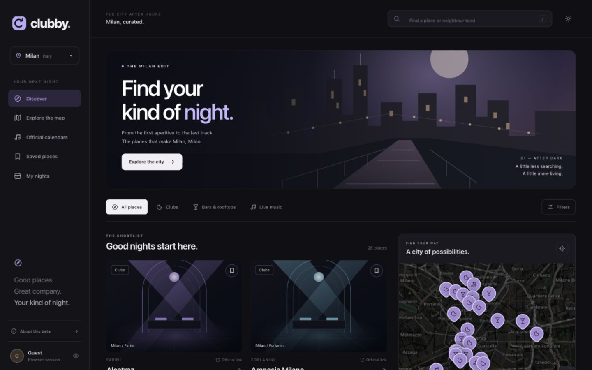

# Clubby

Beta de descubrimiento de vida nocturna en Milán: 28 locales, búsqueda y filtros, mapa, enlaces oficiales, favoritos y planes personales. El frontend de `Clubby-GitHub.zip` está conectado al backend NestJS y a PostgreSQL. Favoritos, planes y perfil persisten al recargar y reiniciar el servidor.



## Ejecutar

Requisitos: Node.js 24 y pnpm 11.19.0.

```sh
npm install --global pnpm@11.19.0
pnpm install --frozen-lockfile
pnpm local --web
```

Abrir **http://localhost:8081**. La API utiliza el puerto 4100 y PostgreSQL el 5433. En Mac con Apple Silicon y Windows x64 el arranque incluye PostgreSQL; en otras plataformas configurar `PG_BIN_DIR` con los binarios de PostgreSQL 17 o `DATABASE_URL` con una base local. Consultar [desarrollo local](docs/runbooks/local-development.md).

En este Mac también está preparado `./.local-tools/bin/pnpm`; es una herramienta local excluida de Git. Los compañeros usan su instalación normal de Node/pnpm.

El arranque crea credenciales aleatorias y conserva la base local. Ctrl+C detiene los procesos que inició, sin borrar los datos. No hacen falta claves de Google ni Stripe para probar la beta. Los planes son personales y las compras se abren en la web oficial de cada local.

## Comprobar

```sh
pnpm check
pnpm local --web --smoke
```

`check` ejecuta TypeScript para API y cliente Expo, pruebas del frontend/servidor web, pruebas sobre PostgreSQL real y builds de backend y beta. La base de pruebas es temporal y está separada de los datos locales. Linux CI utiliza un servicio PostgreSQL explícito. [Guía para el equipo y GitHub](docs/SUBIR-A-GITHUB.md).

La prueba de copia y restauración de la plataforma también requiere `pg_dump` y `pg_restore` 17: configurar `PG_BIN_DIR` con una distribución completa de PostgreSQL 17. Esto no es necesario para arrancar la beta.

## Estructura

- `web/`: beta web activa; configuración pública en `web/config.js`.
- `apps/api/`, `apps/worker/`: API y tareas de la plataforma original.
- `database/`: migraciones y catálogo de Milán.
- `apps/mobile/`: cliente Expo original, con flujos de cuentas y operaciones.
- `packages/`: contratos y servicios compartidos.
- `scripts/local.mjs`: arranque de API, worker, web y base de datos local.
- `index.html`, `milanmap.js`, `qrcode.js`: prototipo original de referencia con funciones simuladas.

La sesión de la beta es anónima y pertenece al navegador. No sincroniza dispositivos; el perfil permite borrar sus datos del servidor. El modo de catálogo sin backend es una vista previa explícita, identificada en pantalla. [Arquitectura y endpoints](docs/BETA-ARCHITECTURE.md).

## Compartir y desplegar

Publicar una rama de revisión en `P4210/Project-Clubby` siguiendo [SUBIR-A-GITHUB](docs/SUBIR-A-GITHUB.md). GitHub aloja el código; una URL de prueba compartida requiere desplegar además web, API y PostgreSQL. `Dockerfile.beta` sirve la beta; el Dockerfile raíz construye la API y el worker. `Dockerfile.web` conserva el cliente Expo.

La plataforma original incluye los flujos de comercio, cuentas y operación. Su activación pública requiere los proveedores y comprobaciones de sus [runbooks](docs/runbooks/deployment.md); el modo local mantiene pagos reales desactivados. Las instrucciones originales se conservan en [ORIGINAL-PLATFORM-README](docs/ORIGINAL-PLATFORM-README.md).

[Fuentes del catálogo](docs/CONTENT-SOURCES.md) · [Componentes y recursos](THIRD-PARTY-NOTICES.md).
